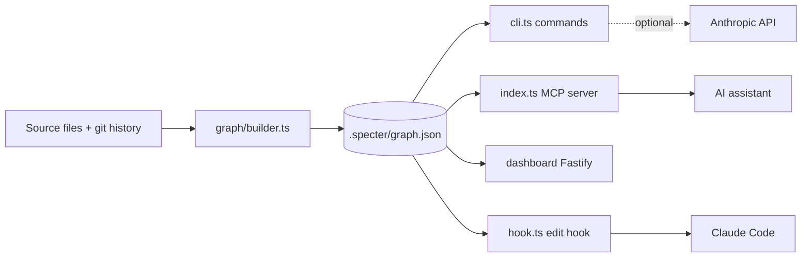

# Specter: onboarding and architecture

Snapshot of `main` at commit a655738. Links are relative to the repo root. This file lives at the root, not in docs/, because docs/ is the gitignored typedoc output directory ([.gitignore:7-8](.gitignore#L7-L8), [typedoc.json:5](typedoc.json#L5)). Anything without a link is marked (inference) or `UNKNOWN`. Sections 1 and 3 are written for non-developers.

## 1. What it is

Specter (`@purplegumdropz/specter`) is a local code-intelligence tool. It reads a TypeScript/JavaScript codebase and its git history, builds a "knowledge graph", and reports where change is risky: complexity hotspots, files that change together, who owns what ([package.json:2-4](package.json#L2-L4), [README.md:10-11](README.md#L10-L11)). It is used three ways: as a CLI, as an MCP server for AI assistants ([src/index.ts:26-38](src/index.ts#L26-L38)), and as a Claude Code hook that briefs an agent before it edits a file ([src/hook.ts:3-12](src/hook.ts#L3-L12)). Everything runs on the user's machine. AI-written answers are optional and need an API key ([src/ai/claude-client.ts:12-14](src/ai/claude-client.ts#L12-L14)).

## 2. Stack

| Layer | Technology | Version | Cited at |
|---|---|---|---|
| Language | TypeScript, strict, NodeNext modules | 6.0.3 | [tsconfig.json:4-10](tsconfig.json#L4-L10), [package.json:111](package.json#L111) |
| Runtime | Node.js | >=20 | [package.json:55-57](package.json#L55-L57) |
| Package manager | pnpm | 10.34.5 | [package.json:171](package.json#L171) |
| Build | `tsc`, then copy dashboard assets, no bundler | n/a | [package.json:22](package.json#L22) |
| CLI | commander | ^15.0.0 | [package.json:81](package.json#L81), [src/cli.ts:35](src/cli.ts#L35) |
| MCP server | @modelcontextprotocol/sdk, stdio transport | ^1.0.0 | [package.json:66](package.json#L66), [src/index.ts:45](src/index.ts#L45) |
| Code analysis | ts-morph | ^28.0.0 | [package.json:93](package.json#L93), [src/analyzers/ast.ts:321](src/analyzers/ast.ts#L321) |
| Git analysis | simple-git | ^4.0.0 | [package.json:91](package.json#L91), [src/analyzers/git.ts:47](src/analyzers/git.ts#L47) |
| Validation | zod | ^4.0.0 | [package.json:94](package.json#L94), [src/graph/schema.ts:5](src/graph/schema.ts#L5) |
| Dashboard | Fastify 5 plus static HTML/JS | ^5.7.0 | [package.json:83](package.json#L83), [src/dashboard/server.ts:30](src/dashboard/server.ts#L30) |
| AI | @anthropic-ai/sdk | ^0.122.0 | [package.json:60](package.json#L60), [src/ai/claude-client.ts:7](src/ai/claude-client.ts#L7) |
| Tracing (optional) | OpenTelemetry, Langfuse | see file | [src/lib/telemetry.ts:32-33](src/lib/telemetry.ts#L32-L33), [src/lib/langfuse.ts:15](src/lib/langfuse.ts#L15) |
| Tests | Vitest 4, jsdom | 4.1.12 | [vitest.config.ts:5-10](vitest.config.ts#L5-L10), [package.json:113](package.json#L113) |
| Lint/format | Biome, Husky, lint-staged | 2.5.15 | [package.json:97](package.json#L97), [package.json:34](package.json#L34) |

## 3. How it works for users

- Scan a repo with `specter scan`. The first scan is full; later scans only re-read changed files ([src/commands/core/scan.ts:87](src/commands/core/scan.ts#L87), [src/graph/changes.ts:51-56](src/graph/changes.ts#L51-L56)).
- See hotspots, health, bus factor, coupling, cycles and cost through CLI commands grouped by category ([src/commands/index.ts:17-38](src/commands/index.ts#L17-L38)).
- Ask questions in plain language with `ask`; the `--ai` option uses Claude ([src/commands/ai/ai-ask.ts:159](src/commands/ai/ai-ask.ts#L159)).
- Read a change-risk brief for one file with `specter brief` ([src/commands/core/brief.ts:1-3](src/commands/core/brief.ts#L1-L3)).
- Let Claude Code receive that brief automatically before every Edit or Write ([src/risk/agent-hook.ts:20](src/risk/agent-hook.ts#L20), [claude-plugin/hooks/hooks.json:4-12](claude-plugin/hooks/hooks.json#L4-L12)).
- Connect an AI assistant to 14 MCP tools, 6 prompts and 4 resources ([src/mcp/tools.ts:29](src/mcp/tools.ts#L29), [src/mcp/prompts.ts:22](src/mcp/prompts.ts#L22), [src/mcp/resources.ts:16](src/mcp/resources.ts#L16)).
- Open a local web dashboard with `specter dashboard` ([package.json:26](package.json#L26), [src/dashboard/server.ts:24](src/dashboard/server.ts#L24)).
- Add PR health comments in CI through the GitHub Action ([action.yml:1-30](action.yml#L1-L30)).

## 4. Architecture

Style: a single TypeScript package with three entry points that share one on-disk data model. There is no database and no network service of its own.

1. **Builder.** `buildKnowledgeGraph` runs AST analysis per file, resolves imports, optionally mines git history, then assembles nodes, edges and metadata ([src/graph/builder.ts:238](src/graph/builder.ts#L238), [:257-308](src/graph/builder.ts#L257-L308)). `updateGraphIncremental` re-analyses only changed files ([src/graph/builder.ts:347](src/graph/builder.ts#L347)).
2. **Store.** The graph is saved to `<repo>/.specter/graph.json` with atomic writes and a SHA-256 provenance record under the user's cache directory ([src/graph/persistence.ts:44-58](src/graph/persistence.ts#L44-L58), [src/graph/provenance.ts:37-44](src/graph/provenance.ts#L37-L44)).
3. **Consumers.** CLI commands ([src/cli.ts:116](src/cli.ts#L116)), the MCP server, which loads and caches the graph and rechecks freshness every second ([src/mcp/core.ts:17](src/mcp/core.ts#L17), [:47-56](src/mcp/core.ts#L47-L56)), the dashboard REST API ([src/dashboard/api.ts:17-18](src/dashboard/api.ts#L17-L18)), and the edit hook ([src/risk/agent-hook.ts:36](src/risk/agent-hook.ts#L36)).
4. **Analysis logic.** MCP tools and the dashboard share functions in `src/tools/` ([src/mcp/tools.ts:10-23](src/mcp/tools.ts#L10-L23), [src/dashboard/api.ts:11-12](src/dashboard/api.ts#L11-L12)). Risk scoring lives in `src/risk/` ([src/risk/scorer.ts:494](src/risk/scorer.ts#L494)).



A request: the user or agent calls an entry point, which loads the graph from disk, runs a pure function over it, and prints or returns text. Writes happen only in `scan` ([src/commands/core/scan.ts:129](src/commands/core/scan.ts#L129)).

## 5. Folder map

```
src/cli.ts            CLI entry (bin: specter) src/cli.ts:35-140
src/index.ts          MCP server entry (bin: specter-mcp)
src/hook.ts           Claude Code edit hook entry (bin: specter-hook)
src/commands/         CLI commands in 7 groups: ai analysis core fun git visualization workflow
src/graph/            builder, persistence, provenance, changes (incremental), schema (zod), types
src/analyzers/        ast, imports, git, complexity, knowledge
src/risk/             brief, agent-hook, scorer, backtest, diff-analyzer
src/mcp/              MCP tools, prompts, resources, shared graph cache (core.ts)
src/tools/            15 files; analysis functions behind MCP tools and the dashboard
src/dashboard/        Fastify server, REST api, static/ front end
src/history/          health snapshots and trends
src/config/           specter.config.json loader (zod)
src/personality/      19 voice modes (formatter, modes, mood)
src/ai/               Anthropic client wrapper
src/lib/              logger, telemetry, langfuse
src/*.ts (root)       about 80 flat feature files such as report.ts, ask.ts, cost.ts
tests/                Vitest tests mirroring src/
claude-plugin/        Claude Code plugin hooks; .claude-plugin/marketplace.json
plugin/               Copilot CLI plugin (hooks.json, mcp-config.json)
packages/specter-roast/  separate npm package
vscode-extension/     separate VS Code extension
action.yml            GitHub Action definition
.github/workflows/    ci, codeql, publish, scorecard, security-audit and others
```

Sources: [CLAUDE.md:38-58](CLAUDE.md#L38-L58), [src/commands/index.ts:5-12](src/commands/index.ts#L5-L12), [package.json:7-11](package.json#L7-L11). The "about 80" count and the 19 mode figure come from a directory listing and [CLAUDE.md:5](CLAUDE.md#L5); the mode list itself was not counted (inference).

## 6. Key components

1. **Graph builder.** Turns source and git history into a graph. [src/graph/builder.ts:238](src/graph/builder.ts#L238). Used by `scan` ([src/commands/core/scan.ts:126](src/commands/core/scan.ts#L126)). Has a 5 minute scan timeout and 10 second per-file figure ([:244-245](src/graph/builder.ts#L244-L245)); the per-file value is passed to a function that ignores it (`_timeoutMs`, [:57](src/graph/builder.ts#L57)).
2. **Incremental change detection.** Decides full or partial rescan. [src/graph/changes.ts:51](src/graph/changes.ts#L51). Used by `scan`. Falls back to a full scan when `tsconfig`/`package.json` changed or over 40% of files changed ([:9-12](src/graph/changes.ts#L9-L12), [:88-91](src/graph/changes.ts#L88-L91)).
3. **Persistence and provenance.** Reads and writes `.specter/`, refuses a symlinked directory, and only trusts graphs this machine wrote. [src/graph/persistence.ts:25-38](src/graph/persistence.ts#L25-L38), [src/graph/provenance.ts:47](src/graph/provenance.ts#L47). Used by `scan`, MCP, dashboard and hook.
4. **Graph schema.** zod validation of the file format; node and edge types are fixed enums. [src/graph/schema.ts:7-25](src/graph/schema.ts#L7-L25), [:36-43](src/graph/schema.ts#L36-L43).
5. **Change-risk brief.** Builds per-file facts (co-change partners, dependents, hotspot rank, tests) and stays silent below thresholds. [src/risk/brief.ts:78](src/risk/brief.ts#L78), thresholds at [:65-73](src/risk/brief.ts#L65-L73). Used by the hook and `specter brief`.
6. **Edit hook.** Reads the hook JSON, finds the graph, returns `additionalContext`, never blocks. [src/risk/agent-hook.ts:36-69](src/risk/agent-hook.ts#L36-L69), [src/hook.ts:29-31](src/hook.ts#L29-L31).
7. **MCP server.** Registers tools, prompts and resources; each tool wraps a 30 second timeout. [src/mcp/tools.ts:29](src/mcp/tools.ts#L29), [src/mcp/core.ts:82-99](src/mcp/core.ts#L82-L99).
8. **Dashboard server.** Fastify with rate limit (100 per minute), localhost-only CORS and static files. [src/dashboard/server.ts:33-60](src/dashboard/server.ts#L33-L60).

## 7. Data and storage

There is no database. State is files:

- `<repo>/.specter/graph.json` and `metadata.json`, plus a self-ignoring `.gitignore` inside `.specter/` ([src/graph/persistence.ts:18-20](src/graph/persistence.ts#L18-L20), [:57-58](src/graph/persistence.ts#L57-L58)).
- Graph shape: `version`, `metadata`, `nodes` (record), `edges`, optional `coChange` and `unresolvedImporters` ([src/graph/schema.ts:36-43](src/graph/schema.ts#L36-L43)). Node types: file, function, class, interface, type, variable, enum. Edge types: imports, exports, calls, extends, implements, uses, contains ([src/graph/schema.ts:7-25](src/graph/schema.ts#L7-L25)).
- Health snapshots are saved on every graph save, failures ignored ([src/graph/persistence.ts:60-66](src/graph/persistence.ts#L60-L66)). Their on-disk location: UNKNOWN (not read, see [src/history/storage.ts](src/history/storage.ts)).
- Per-user cache: `~/.cache/specter/graphs/` (override `SPECTER_CACHE_DIR`) and `~/.cache/specter/hook-sessions/` with a 7 day expiry ([src/graph/provenance.ts:16-20](src/graph/provenance.ts#L16-L20), [src/risk/agent-hook.ts:71-72](src/risk/agent-hook.ts#L71-L72)).
- Scan lock at `.specter/scan.lock`, treated as stale after 10 minutes ([src/scan-lock.ts:7-8](src/scan-lock.ts#L7-L8)).
- Row-level security, users, auth tables: UNKNOWN, none in this repo (no schema or migrations found).
- In-memory cache: the MCP server keeps one graph ([src/mcp/core.ts:13](src/mcp/core.ts#L13)); config is cached per root ([src/config/index.ts:265](src/config/index.ts#L265)).

## 8. Two critical flows

**A. `specter scan`**

1. `cli.ts` registers all commands and parses argv ([src/cli.ts:116](src/cli.ts#L116), [:140](src/cli.ts#L140)).
2. `scan` loads a trusted graph unless `--force` ([src/commands/core/scan.ts:66](src/commands/core/scan.ts#L66)).
3. If the graph exists and is not stale, it stops ([:67-72](src/commands/core/scan.ts#L67-L72)). Staleness compares file mtimes with `scannedAt` ([src/graph/persistence.ts:152-186](src/graph/persistence.ts#L152-L186)).
4. It takes a scan lock; a live competing scan makes it exit 1 ([:77-82](src/commands/core/scan.ts#L77-L82)).
5. It asks git for changed files; `null` means do a full scan ([:87](src/commands/core/scan.ts#L87)).
6. Incremental or full build ([:123-126](src/commands/core/scan.ts#L123-L126)).
7. Full build: ts-morph project, per-file AST and imports, then git history and co-change ([src/graph/builder.ts:257](src/graph/builder.ts#L257), [:272](src/graph/builder.ts#L272), [:293](src/graph/builder.ts#L293)).
8. Graph assembled with dirty-file list and co-change accuracy ([src/graph/builder.ts:299-308](src/graph/builder.ts#L299-L308), [:219-222](src/graph/builder.ts#L219-L222)).
9. `saveGraph` writes graph, records its hash, writes metadata and a snapshot ([src/graph/persistence.ts:44-66](src/graph/persistence.ts#L44-L66)).

**B. Claude edits a file (hook)**

1. Claude Code runs `brief.sh` on Edit, Write or MultiEdit ([claude-plugin/hooks/hooks.json:4-9](claude-plugin/hooks/hooks.json#L4-L9)); it exits silently if `specter-hook` is not installed ([claude-plugin/hooks/brief.sh:4-5](claude-plugin/hooks/brief.sh#L4-L5)).
2. `hook.ts` reads JSON from stdin ([src/hook.ts:17-19](src/hook.ts#L17-L19)).
3. `runHook` ignores non-edit tools ([src/risk/agent-hook.ts:37](src/risk/agent-hook.ts#L37)).
4. It walks up to find `.specter/graph.json`; no graph means no output ([:42-43](src/risk/agent-hook.ts#L42-L43)).
5. Files already briefed this session are skipped ([:47](src/risk/agent-hook.ts#L47)).
6. A symlinked `.specter` is refused ([:51](src/risk/agent-hook.ts#L51)).
7. The graph bytes must match the recorded hash ([:56-57](src/risk/agent-hook.ts#L56-L57)).
8. The brief is built and rendered; empty text means no output ([:59-60](src/risk/agent-hook.ts#L59-L60)).
9. Output is a `PreToolUse` `additionalContext` object ([:63-68](src/risk/agent-hook.ts#L63-L68)); any error is swallowed ([src/hook.ts:29-31](src/hook.ts#L29-L31)).

## 9. Integrations

| Service | Use | Where | Env var names | If down |
|---|---|---|---|---|
| Anthropic API | AI answers in `ask`, `explain`, `review` | [src/ai/claude-client.ts:23-33](src/ai/claude-client.ts#L23-L33) | `ANTHROPIC_API_KEY` | Returns a message string for 401, 429 and other errors ([:51-66](src/ai/claude-client.ts#L51-L66)) |
| Langfuse | Optional tracing | [src/lib/langfuse.ts:18-32](src/lib/langfuse.ts#L18-L32) | `LANGFUSE_PUBLIC_KEY`, `LANGFUSE_SECRET_KEY`, `LANGFUSE_BASE_URL`, `LANGFUSE_HOST`, `VERCEL_GIT_COMMIT_SHA`, `NODE_ENV` | UNKNOWN (export failure handling not read) |
| OpenTelemetry | Optional tracing | [src/lib/telemetry.ts:32-60](src/lib/telemetry.ts#L32-L60) | `OTEL_ENABLED`, `OTEL_EXPORTER_OTLP_ENDPOINT`, `OTEL_SERVICE_NAME` | UNKNOWN |
| GitHub API | PR review command | [src/commands/workflow/review.ts:35-39](src/commands/workflow/review.ts#L35-L39) | `GITHUB_TOKEN` | Prints a message and returns if token missing; API failure UNKNOWN |
| GitHub Actions | PR comments | [action.yml:5-30](action.yml#L5-L30) | `SPECTER_PERSONALITY` ([action.yml:67](action.yml#L67)) | UNKNOWN |
| npm registry | Publish on release | [.github/workflows/publish.yml:3-5](.github/workflows/publish.yml#L3-L5) | none seen | n/a |
| Copilot CLI / Claude Code | Plugin hosts | [plugin/hooks.json](plugin/hooks.json), [claude-plugin/hooks/hooks.json](claude-plugin/hooks/hooks.json) | none | Hooks exit 0 when specter is missing ([claude-plugin/hooks/refresh.sh:4](claude-plugin/hooks/refresh.sh#L4)) |

`@ai-sdk/google` is a dependency ([package.json:59](package.json#L59)) but no import of it was found under `src/` (searched with grep). Whether anything uses it: UNKNOWN.

## 10. Config and environments

- **Required env vars:** none. All are optional ([src/ai/claude-client.ts:25](src/ai/claude-client.ts#L25), [src/lib/telemetry.ts:34](src/lib/telemetry.ts#L34)).
- **AI:** `ANTHROPIC_API_KEY`. **Tracing:** Langfuse and OTEL names in section 9. **Behaviour:** `SPECTER_ACCESSIBLE` ([src/cli.ts:38](src/cli.ts#L38)), `SPECTER_CACHE_DIR` ([src/graph/provenance.ts:17](src/graph/provenance.ts#L17)), `LOG_LEVEL` ([src/lib/logger.ts:22](src/lib/logger.ts#L22)), `GITHUB_TOKEN`.
- `.env.example`: UNKNOWN, none exists in the repo (find returned nothing). The env list above comes from `process.env[...]` reads in `src/`.
- Project config: `specter.config.json` in the scanned repo, validated by zod, falling back to defaults with a warning ([src/config/index.ts:270-299](src/config/index.ts#L270-L299)); template in [specter.config.example.json](specter.config.example.json). Dashboard default `localhost:3333` ([src/config/index.ts:209](src/config/index.ts#L209)).
- **Run locally:** `pnpm install`, `pnpm build`, `pnpm scan`, `pnpm dashboard` ([CONTRIBUTING.md:12-19](CONTRIBUTING.md#L12-L19), [package.json:22-26](package.json#L22-L26)).
- **Test/lint:** `pnpm test:run`, `pnpm lint` ([package.json:28-30](package.json#L28-L30)).
- **Deploy:** npm publish on GitHub release, Node 20 ([.github/workflows/publish.yml:3-5](.github/workflows/publish.yml#L3-L5), [:23-25](.github/workflows/publish.yml#L23-L25)). Hosting of a dashboard: UNKNOWN, it is a local server.

## 11. Tests and quality

- 37 test files (`*.test.ts` and `.tsx` found by `find`), mostly under `tests/` mirroring `src/` ([CONTRIBUTING.md:54](CONTRIBUTING.md#L54)). Areas: graph, risk, mcp, analyzers, commands ([tests/graph/builder.test.ts](tests/graph/builder.test.ts), [tests/risk/brief.test.ts](tests/risk/brief.test.ts), [tests/mcp/core.test.ts](tests/mcp/core.test.ts)).
- Runner: Vitest with jsdom and globals ([vitest.config.ts:7-10](vitest.config.ts#L7-L10)). Tests that create git repos must neutralise global git config ([CLAUDE.md:87-88](CLAUDE.md#L87-L88)).
- CI: lint, coverage, build, audit and CodeQL ([.github/workflows/ci.yml:31-35](.github/workflows/ci.yml#L31-L35), [:61-62](.github/workflows/ci.yml#L61-L62), [:84-85](.github/workflows/ci.yml#L84-L85)). The audit step does not fail the build ([:86](.github/workflows/ci.yml#L86)).
- Gap: 37 test files against roughly 80 flat feature files plus 7 command groups in `src/` (inference). Coverage percentage: UNKNOWN (not run).

## 12. Security notes

- No user accounts or auth: it is a local tool (inference from section 7).
- Untrusted-repo defence: the hook only reads a graph whose hash this machine recorded ([src/graph/provenance.ts:3-9](src/graph/provenance.ts#L3-L9)), and a symlinked `.specter/` is refused ([src/graph/persistence.ts:30-32](src/graph/persistence.ts#L30-L32)).
- Private cache files use modes 0700 and 0600 ([src/risk/agent-hook.ts:91-99](src/risk/agent-hook.ts#L91-L99)).
- Dashboard: CORS limited to localhost origins, 100 requests per minute ([src/dashboard/server.ts:33-53](src/dashboard/server.ts#L33-L53)). Default host is `localhost` ([src/config/index.ts:87](src/config/index.ts#L87)), but the host is configurable, so a non-local bind is possible (inference).
- Secrets are read from env only (`ANTHROPIC_API_KEY`, `GITHUB_TOKEN`, Langfuse keys). Contributor rule: no shell string interpolation ([CONTRIBUTING.md:62-67](CONTRIBUTING.md#L62-L67)).
- Reporting: GitHub Security Advisories ([SECURITY.md:11-13](SECURITY.md#L11-L13)).

## 13. Risks and technical debt

- MCP server reports version `1.0.0` while the package is 1.3.0 ([src/index.ts:29](src/index.ts#L29), [package.json:3](package.json#L3)).
- npm `latest` is older than `main`; brief, backtest and plugin are unpublished ([README.md:78](README.md#L78)).
- Per-file scan timeout parameter is unused ([src/graph/builder.ts:54-57](src/graph/builder.ts#L54-L57)); `_withTimeout` is also unused in the lines read ([:44](src/graph/builder.ts#L44)).
- Large flat files: `src/report.ts` 1076 lines, `src/ask.ts` 1074, `src/fix.ts` 924 (from `wc -l`, run on this checkout).
- CONTRIBUTING says commands are "being refactored", and many feature files still sit at `src/` root ([CONTRIBUTING.md:99](CONTRIBUTING.md#L99), [src/cli.ts:19](src/cli.ts#L19)).
- `@ai-sdk/google` appears unused ([package.json:59](package.json#L59)).
- The pre-commit hook calls a script in the developer's home directory if present ([.husky/pre-commit:5-7](.husky/pre-commit#L5-L7)). Behaviour on other machines: it is skipped when absent.
- `pnpm.overrides` can be dropped by Dependabot and break CI ([CLAUDE.md:67-69](CLAUDE.md#L67-L69)).

## 14. Where to start reading

1. [src/graph/types.ts](src/graph/types.ts) and [src/graph/schema.ts](src/graph/schema.ts): the data model everything uses.
2. [src/commands/core/scan.ts](src/commands/core/scan.ts): how the graph gets made, locked and saved.
3. [src/graph/builder.ts](src/graph/builder.ts): the build pipeline.
4. [src/graph/persistence.ts](src/graph/persistence.ts) and [src/graph/provenance.ts](src/graph/provenance.ts): storage and the trust model.
5. [src/risk/brief.ts](src/risk/brief.ts) and [src/risk/agent-hook.ts](src/risk/agent-hook.ts): the newest product feature.
6. [src/mcp/core.ts](src/mcp/core.ts) and [src/mcp/tools.ts](src/mcp/tools.ts): the MCP surface.
7. [src/cli.ts](src/cli.ts) and [src/commands/index.ts](src/commands/index.ts): command wiring.
8. [CLAUDE.md](CLAUDE.md): maintainer notes on gotchas.

## 15. Analysis limits

- Read in full or in large part: root docs, `package.json`, `tsconfig.json`, `vitest.config.ts`, `src/cli.ts`, `src/index.ts`, `src/hook.ts`, `src/graph/`, `src/risk/{agent-hook,brief}.ts`, `src/mcp/{core,tools}.ts`, `src/dashboard/{server,api}.ts` (head), `src/ai/claude-client.ts`, `src/lib/{langfuse,telemetry}.ts`, `src/config/index.ts` (partial), `.github/workflows/ci.yml`, plugin hook files.
- Skipped or only listed or grepped: the roughly 80 root `src/*.ts` feature files, `src/commands/*` handlers beyond `scan` and `review`, `src/tools/`, `src/analyzers/` internals, `src/history/`, `src/personality/`, `src/ui/`, `src/dashboard/static/`, `packages/specter-roast/`, `vscode-extension/`, most workflows, all test bodies. Reading them would remove the limits on command behaviour and test coverage.
- `scorer.ts` and `backtest.ts` were not read beyond exports; how risk scores are weighted is UNKNOWN here.
- Nothing was run: no build, tests or coverage, so test status and the real command count (74 is from [CLAUDE.md:5](CLAUDE.md#L5)) are unverified.
- Telemetry and GitHub failure behaviour: UNKNOWN until the error handling in those paths is read.
- Line numbers match commit a655738 and will drift.
